# Mermaid

## 索引目錄

- [簡介](#簡介)
- [流程圖 (Flowchart)](#流程圖-flowchart)
- [時序圖 (Sequence Diagram)](#時序圖-sequence-diagram)
- [類別圖 (Class Diagram)](#類別圖-class-diagram)
- [狀態圖 (State Diagram)](#狀態圖-state-diagram)
- [實體關係圖 (ER Diagram)](#實體關係圖-er-diagram)
- [甘特圖 (Gantt Chart)](#甘特圖-gantt-chart)
- [圓餅圖 (Pie Chart)](#圓餅圖-pie-chart)
- [實用資源](#實用資源)

---

## 簡介

Mermaid 是一種以純文字描述圖表的語法，可在 Markdown 中直接渲染成圖形。

````markdown
```mermaid
圖表類型
  圖表內容
```
````

支援環境：GitHub、GitLab、Notion、VS Code（需插件）、Obsidian 等。

---

## 流程圖 (Flowchart)

### 基本語法

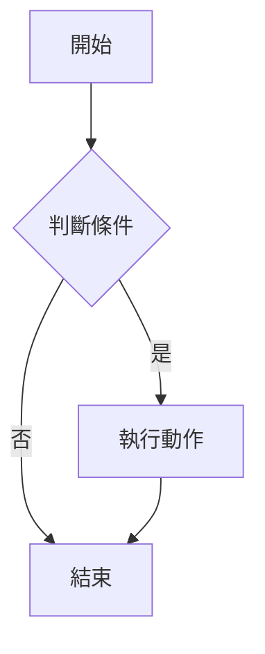

### 方向

| 語法 | 方向 |
| :--- | :--- |
| `TD` / `TB` | 上到下 |
| `BT` | 下到上 |
| `LR` | 左到右 |
| `RL` | 右到左 |

### 節點形狀

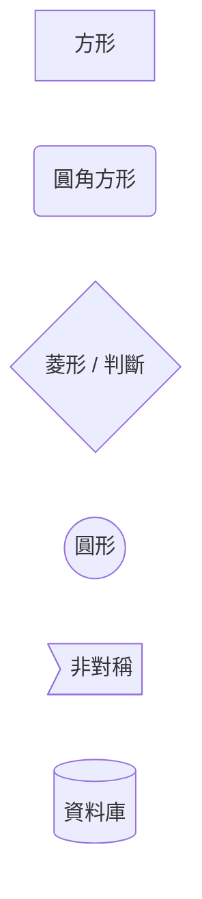

| 語法 | 形狀 | 常用於 |
| :--- | :--- | :--- |
| `[文字]` | 方形 | 一般步驟 |
| `(文字)` | 圓角方形 | 開始/結束 |
| `{文字}` | 菱形 | 判斷/條件 |
| `((文字))` | 圓形 | 事件 |
| `[(文字)]` | 資料庫形 | 儲存 |

### 連線樣式

```mermaid
flowchart LR
    A --> B          %% 實線箭頭
    C --- D          %% 實線無箭頭
    E -.-> F         %% 虛線箭頭
    G ==> H          %% 粗線箭頭
    I -- 標籤 --> J  %% 帶文字的連線
```

| 語法 | 樣式 |
| :--- | :--- |
| `-->` | 實線箭頭 |
| `---` | 實線無箭頭 |
| `-.->` | 虛線箭頭 |
| `==>` | 粗線箭頭 |
| `-- 文字 -->` | 帶標籤的連線 |

### 子圖 (Subgraph)

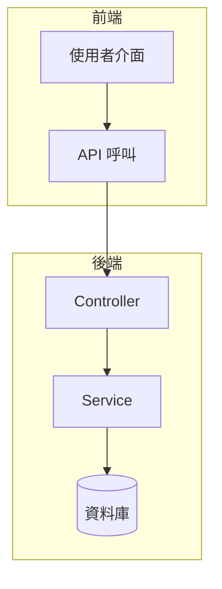

---

## 時序圖 (Sequence Diagram)

描述多個參與者之間的訊息互動流程。

### 基本語法

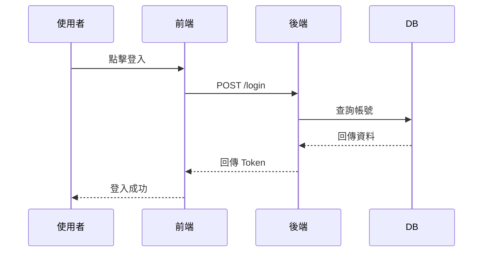

### 訊息類型

| 語法 | 樣式 |
| :--- | :--- |
| `->>` | 實線箭頭（請求） |
| `-->>` | 虛線箭頭（回應） |
| `->` | 實線無箭頭 |
| `-->` | 虛線無箭頭 |

### 進階語法

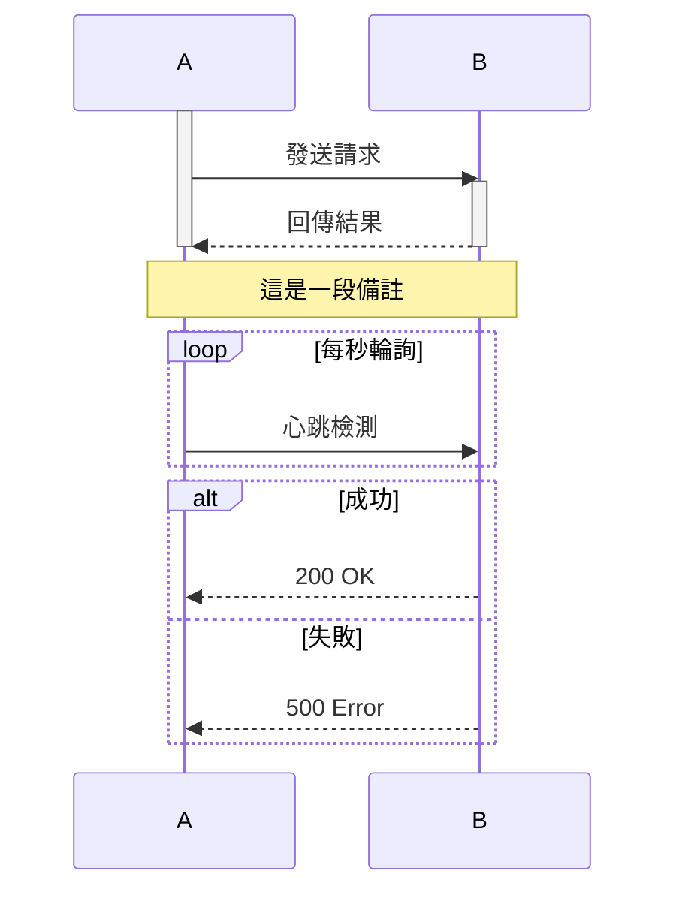

---

## 類別圖 (Class Diagram)

描述物件導向的類別結構與關係。

### 基本語法

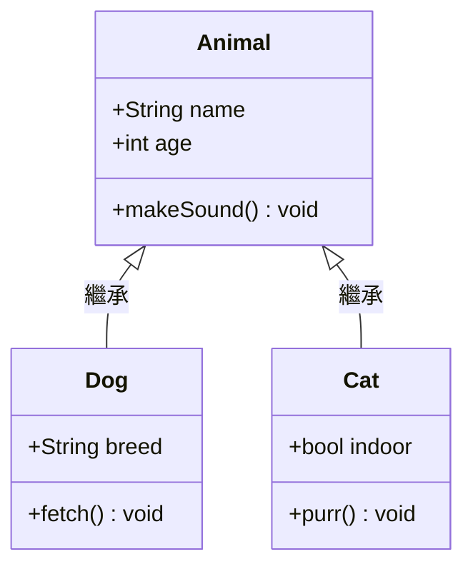

### 存取修飾符

| 符號 | 意義 |
| :---: | :--- |
| `+` | public |
| `-` | private |
| `#` | protected |
| `~` | package |

### 關係類型

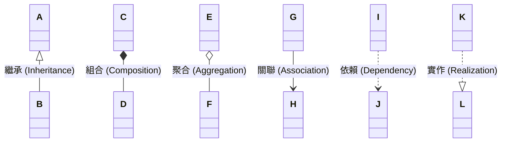

| 語法 | 關係 |
| :--- | :--- |
| `<\|--` | 繼承 |
| `*--` | 組合（強擁有） |
| `o--` | 聚合（弱擁有） |
| `-->` | 關聯 |
| `..>` | 依賴 |
| `..\|>` | 實作介面 |

---

## 狀態圖 (State Diagram)

描述系統在不同狀態間的轉換。

### 基本語法

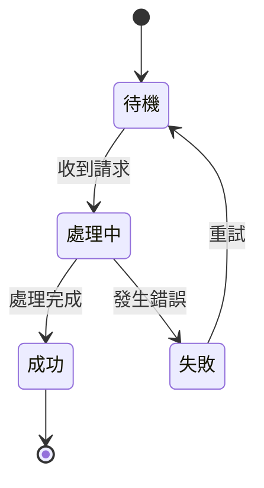

> `[*]` 代表開始或結束狀態。

### 巢狀狀態

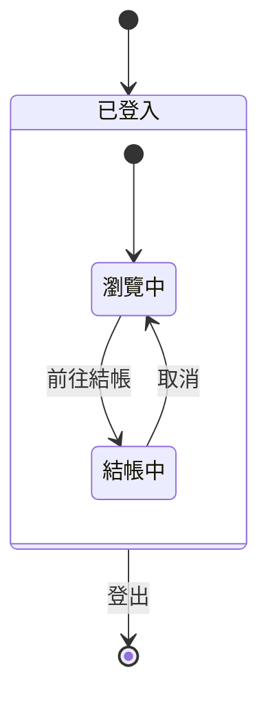

---

## 實體關係圖 (ER Diagram)

描述資料庫的資料表結構與關聯。

### 基本語法

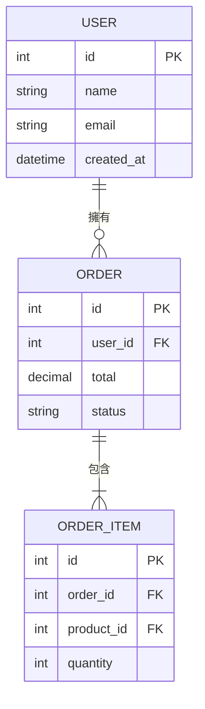

### 關係符號

| 符號 | 意義 |
| :--- | :--- |
| `\|\|` | 恰好一個 |
| `o\|` | 零個或一個 |
| `\|{` | 一個或多個 |
| `o{` | 零個或多個 |

範例：`USER ||--o{ ORDER` = 一個 USER 對應零個或多個 ORDER。

---

## 甘特圖 (Gantt Chart)

描述專案時程與任務排程。

### 基本語法

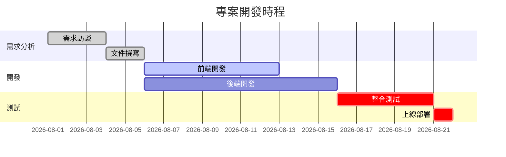

### 任務狀態標籤

| 標籤 | 顯示效果 |
| :--- | :--- |
| `done` | 已完成（灰色） |
| `active` | 進行中（藍色） |
| `crit` | 關鍵路徑（紅色） |
| 無標籤 | 預設（綠色） |

---

## 圓餅圖 (Pie Chart)

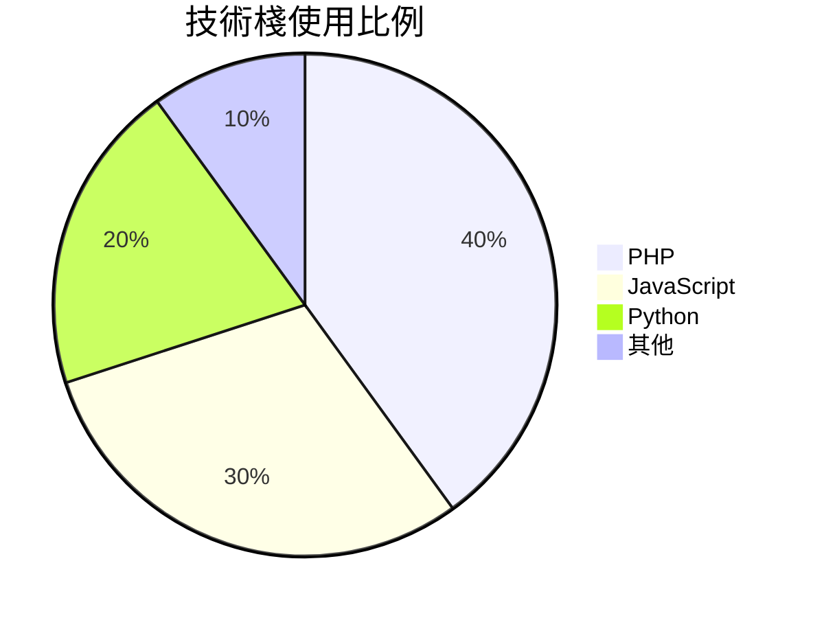

---

## 實用資源

- [Mermaid 官方文件](https://mermaid.js.org/)
- [Mermaid Live Editor](https://mermaid.live/)（即時預覽）
